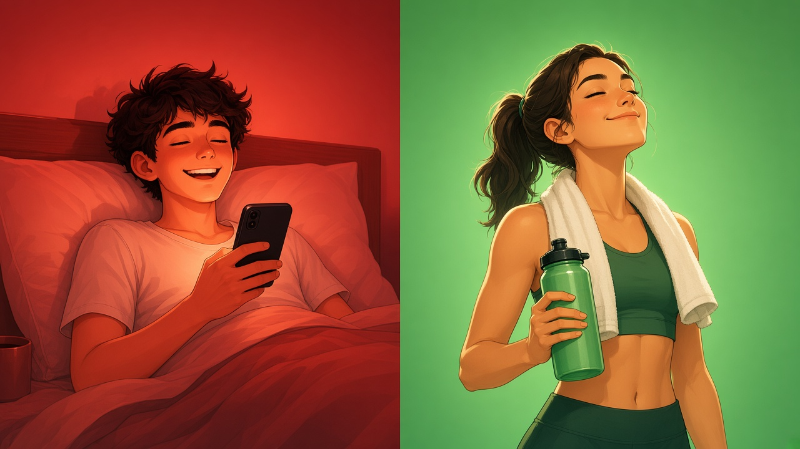
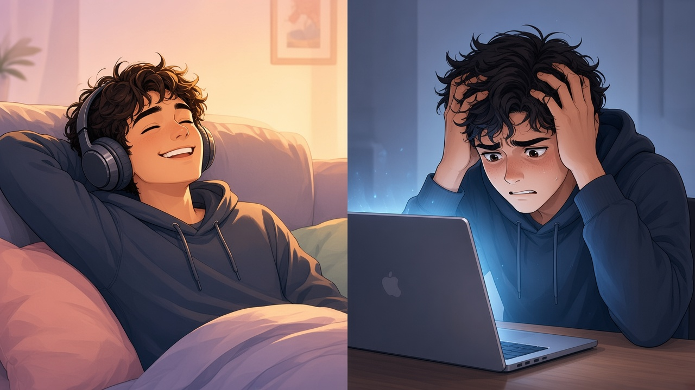
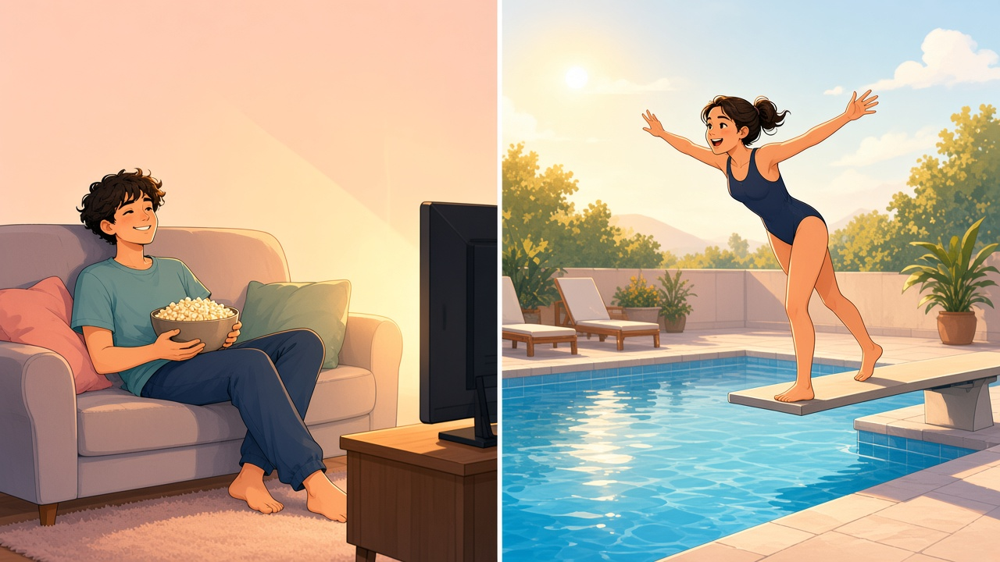
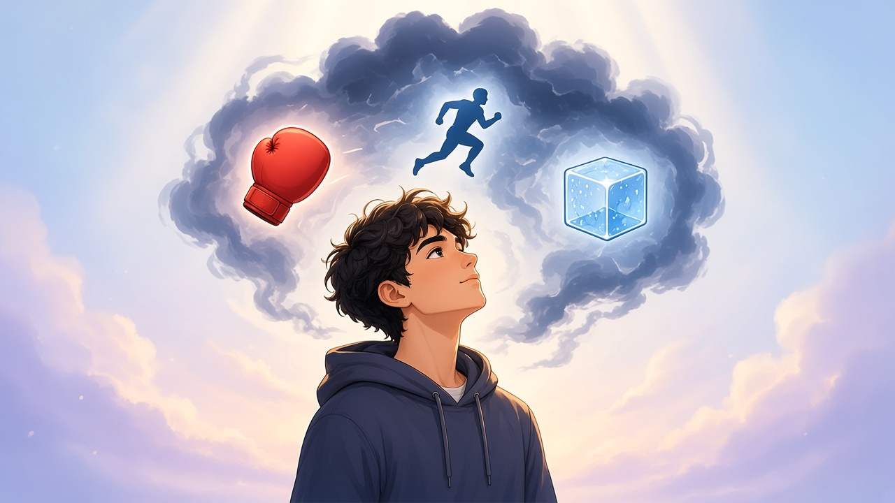
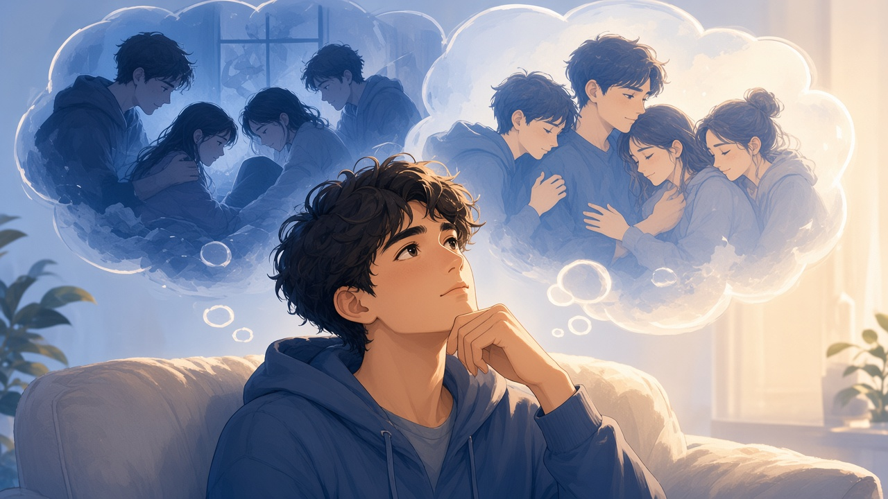
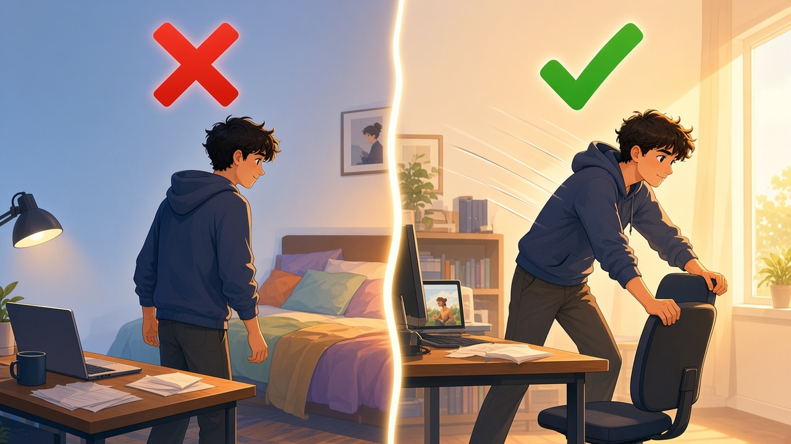

<!-- _class: lead -->

# Rationaliser la peur
## Pour rester dans l'inconfort et arrêter de fuir

Réflexion

Une réflexion sur la **procrastination**,
le **plaisir** et nos **mécanismes de défense**.

---

# 1. Deux types d'activités

### Type A
😊 Plaisir pendant
😣 Culpabilité / regrets après

**Exemples**
- Mini-séries
- Scroll compulsif
- Nuits trop courtes

### Type B
😣 Inconfort avant
😊 Plaisir pendant
🥰 Satisfaction après

**Exemples**
- Sport
- Travail
- Apprentissage
- Activités sociales

---

# 2. Le piège du « plaisir immédiat »

### Ce qu'on imagine
Plaisir immédiat = 😊

### Ce qu'on oublie
😊 Plaisir → 😔 Culpabilité → 😣 Regrets

Le plaisir immédiat n'est pas toujours uniquement du plaisir.

---

# 3. Le plaisir différé : une fausse opposition ?

### Vision classique
Effort maintenant → Plaisir plus tard

### Mon expérience
Inconfort AVANT → Plaisir PENDANT → Satisfaction APRÈS

Le vrai problème ? La difficulté de commencer.

---

# 4. Le coût du démarrage

### Regarder une série
Envie → Clic → Plaisir

### Aller à la piscine
Envie → Hésitation → Résistance → Départ → Plaisir → Satisfaction

Le problème n'est pas toujours l'activité, mais son démarrage.

---

# 5. Face à la peur

## Fight — Flight — Freeze

🥊 Combattre
🏃 Fuir
🧊 Se figer

### Dans la vie quotidienne
- On reste bloqué devant une tâche
- On repousse une décision
- On se réfugie dans une distraction

L'évitement peut devenir automatique.

---

# 6. Pourquoi rationalisons-nous ?

### Exemple familial
Une situation douloureuse

↓ « Il a beaucoup souffert. »
↓ « Il a eu une vie difficile. »
↓ « C'est la dernière fois. »

Soulagement émotionnel temporaire

On rationalise pour rendre une réalité moins douloureuse.

---

# 7. Deux usages de la rationalisation

## ❌ Pour fuir
« Je suis fatigué. »
« Je commencerai demain. »
« Ce n'est pas le bon moment. »

↓ **Évitement**

## ✅ Pour agir
« Cette peur est normale. »
« Je comprends ce qui me dérange. »
« Je peux commencer malgré elle. »

↓ **Action**

---

# 8. L'inconfort est NORMAL

Il est normal de ressentir :
- De la peur
- De l'appréhension
- De la contrariété
- De la résistance

Ne pas avoir envie ne signifie pas ne pas pouvoir agir.

---

# 9. Comprendre plutôt que fuir

### Ancien automatisme
Inconfort → Fuite → Soulagement temporaire → Problème toujours présent

### Nouvel automatisme
Inconfort → Observation → Compréhension → Acceptation → Action

Rester avec l'émotion sans lui obéir automatiquement.

---

# 10. L'habitude change notre expérience

Résistance importante

↓ Action malgré l'inconfort

↓ Expérience positive

↓ Confiance renforcée

↓ Résistance parfois moins forte

La satisfaction d'agir devient elle-même motivante.

---

# 11. Le véritable bonheur ?

### Ce n'est pas forcément
Une vie sans difficultés
Une motivation permanente
L'absence d'émotions négatives

### C'est peut-être aussi
Comprendre ses émotions
Accepter l'inconfort
Agir malgré la peur
Résoudre ce qui peut l'être

La sérénité est une capacité qui se développe.

---

# 12. Conclusion

## Et si on changeait de stratégie ?

Au lieu de :
**Rationaliser notre fuite pour éviter l'inconfort**

Apprenons à :
**Rationaliser l'inconfort pour arrêter de fuir.**

La peur peut être normale. Le démarrage peut être difficile. Et le plaisir peut commencer dès l'action.

